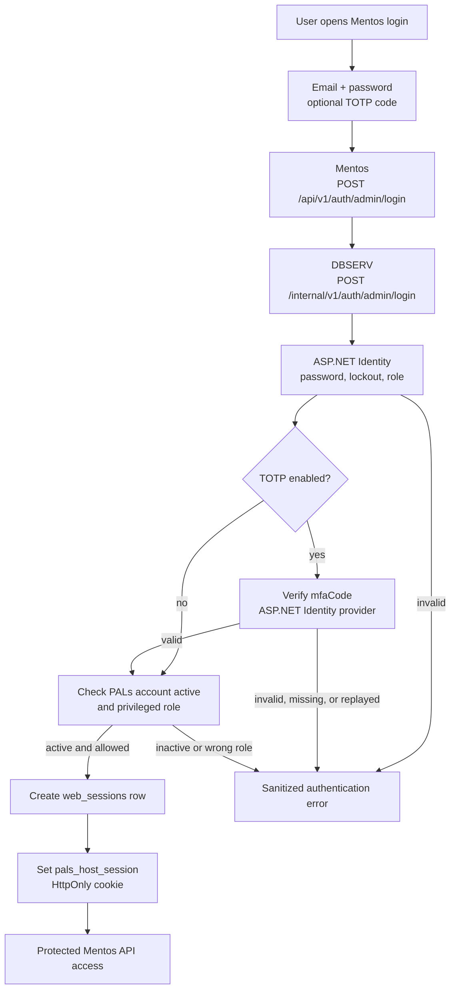
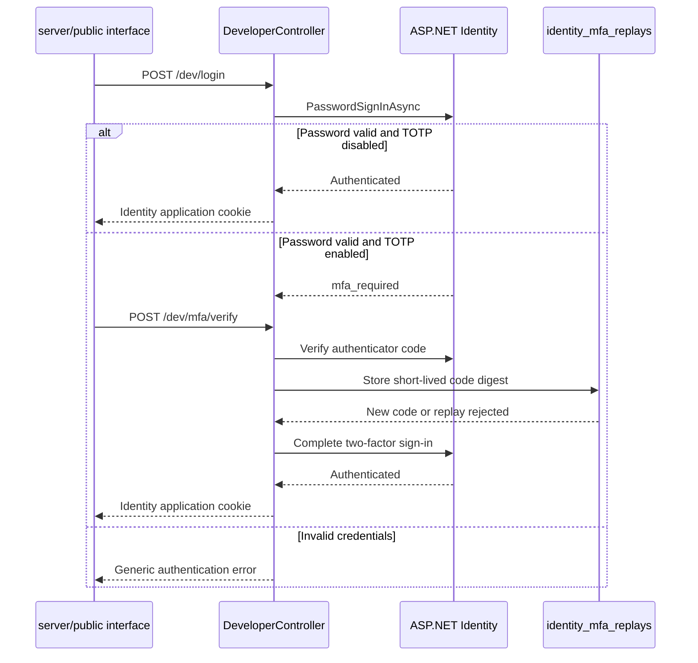
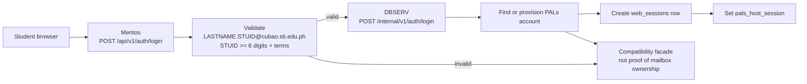
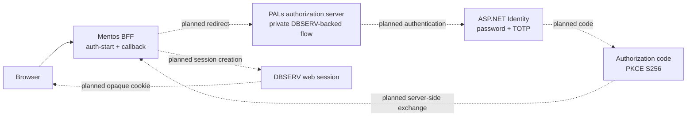

# Pre-established PALs authentication flows

This diagram documents what is active now and separates it from the planned
PALs OAuth/OIDC flow. Google Sign-In and Microsoft Entra are not active
providers. Google Authenticator is only a compatible TOTP client for the
PALs-owned Identity account.

## Current admin/developer flow through Mentos

## Direct DBSERV developer interface flow

## Current student compatibility flow

## Planned OAuth/OIDC flow — not implemented

The dashed flow is a design target from the OAuth/OIDC implementation plan. It
must not be treated as an active route until the authorization-server,
transaction-store, key, redirect, and end-to-end tests are implemented.
