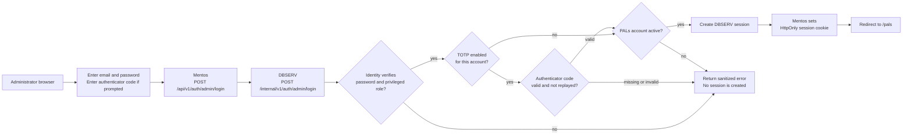
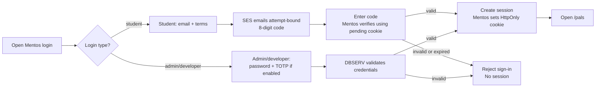

# PALs login flow

This document describes the active Mentos-to-DBSERV login paths. The student
email code is bound to the attempt ID held in the browser's HttpOnly pending
cookie. Email codes are eight digits; this reduces, but cannot mathematically
eliminate, collisions between short numeric codes.

## Student email-code login

```mermaid
flowchart LR
    Browser["Student browser"]
    Login["Open login modal\nChoose student login"]
    Form["Enter school email\nAccept terms"]
    Start["Mentos\nPOST /api/v1/auth/login"]
    HostCheck{"Rate limit, email\nand terms valid?"}
    Create["DBSERV\nPOST /internal/v1/auth/login\nCreate pending attempt ID"]
    Code["Derive per-user secret\nGenerate 8-digit TOTP\nBind code to attempt ID"]
    SES["Send code through AWS SES"]
    Pending["Mentos stores attempt ID in\npals_host_pending\nHttpOnly, short-lived cookie"]
    Enter["Browser enters emailed code"]
    Verify["Mentos\nPOST /api/v1/verify\nRead attempt ID from cookie"]
    Check{"DBSERV verifies code\nfor that attempt?\nExpiry, attempts, replay"}
    Provision["Provision/find PALs account\nRecord terms acceptance"]
    Session["Create DBSERV session"]
    SessionCookie["Mentos sets\npals_host_session\nHttpOnly cookie\nClears pending cookie"]
    Pals["Redirect to /pals"]
    AuthError["Return sanitized error\nNo session is created"]
    SessionCheck["Protected request checks\npersisted DBSERV session"]

    Browser --> Login --> Form --> Start --> HostCheck
    HostCheck -->|"invalid or limited"| AuthError
    HostCheck -->|"valid"| Create --> Code --> SES
    SES -->|"delivery failed"| AuthError
    SES -->|"sent; attempt metadata returned"| Pending --> Enter
    Enter --> Verify --> Check
    Check -->|"invalid, expired, or replayed"| AuthError
    Check -->|"valid"| Provision --> Session --> SessionCookie --> Pals --> SessionCheck
```

The browser submits only the code to Mentos. Mentos obtains the attempt ID from
the HttpOnly cookie and forwards both values to DBSERV. The verifier calculates
the expected code using the submitted attempt's ID and user secret, so a code
from another attempt will normally fail. An eight-digit numeric-code collision
is still theoretically possible; requiring eight digits and limiting failed
attempts substantially reduces that risk.

## Administrator/developer login

## Simplified login flow

