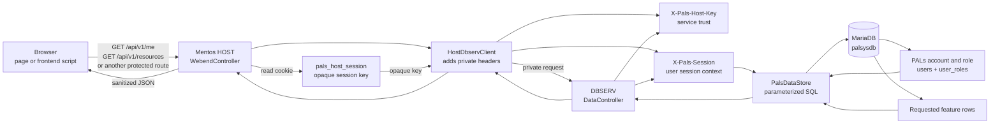
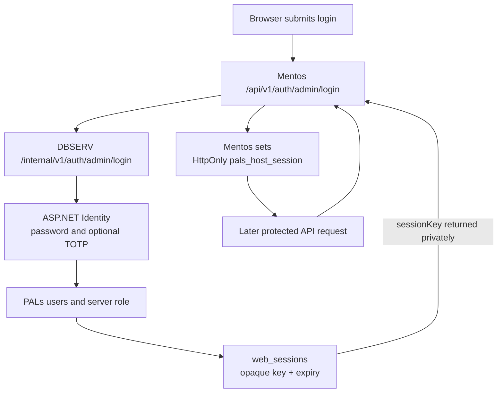

# Mentos to DBSERV to MariaDB

This file combines the three-service path for an authenticated data request.
It shows where the browser cookie is used, where the private service headers
are added, and where the user/session data is resolved in MariaDB.

## Login creates the state used by later requests

The browser does not receive the database connection, host shared key, or raw
database credentials. It receives only the opaque browser session cookie.
