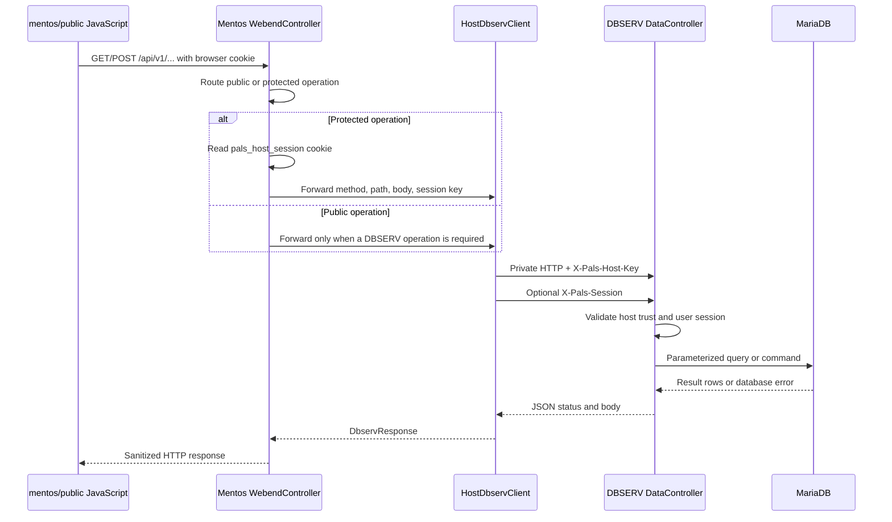

# Mentos API requests to DBSERV

This flow follows a request initiated by a page or script in `mentos/public/`.
The browser calls Mentos only. Mentos decides whether the request is public or
session-protected, then forwards the appropriate private operation to DBSERV.

Examples of public-to-private mappings include:

| Browser-facing Mentos route | Private DBSERV route |
|---|---|
| `POST /api/v1/auth/admin/login` | `POST /internal/v1/auth/admin/login` |
| `GET /api/v1/session` | `GET /internal/v1/auth/session` |
| `GET /api/v1/me` | `GET /internal/v1/me` |
| `GET /api/v1/resources` | `GET /internal/v1/resources` |
| `GET /api/v1/schedule` | `GET /internal/v1/schedule` |
| `POST /api/v1/analytics/events` | `POST /internal/v1/analytics/events` |

Tutor recommendations are currently a deliberate HTTP 501 response from
Mentos; `/connect` matching is not part of this active request flow.
