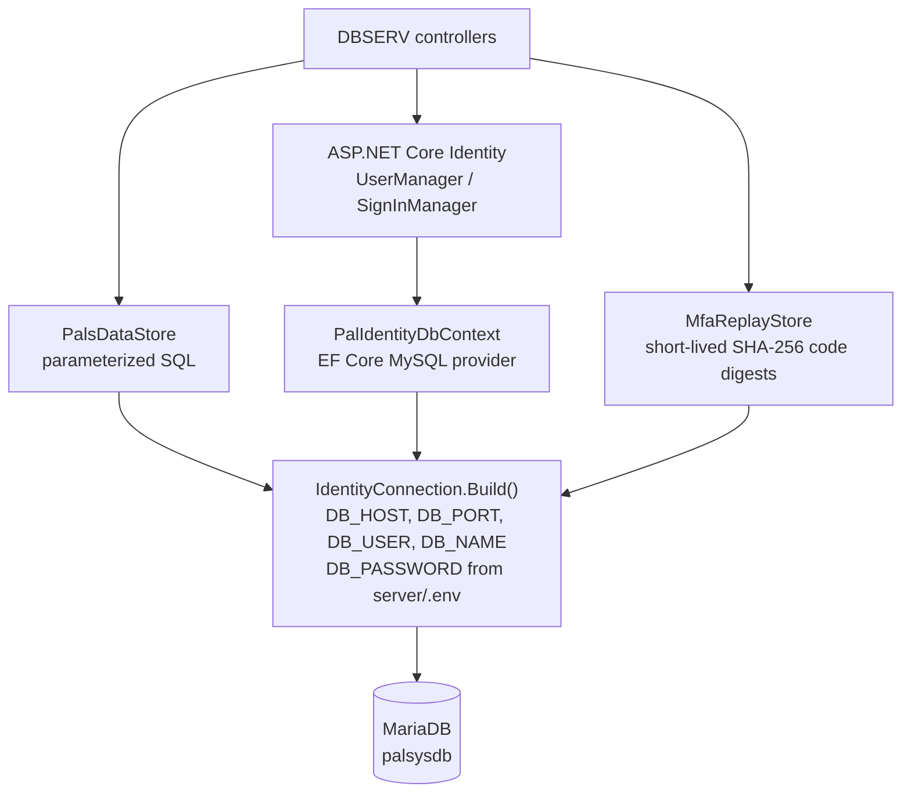
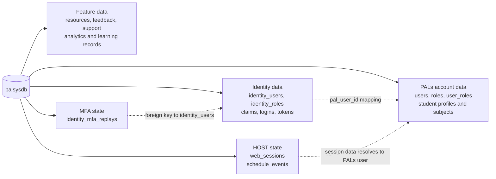

# DBSERV to MariaDB

DBSERV has two database access paths. PALs application data and HOST sessions
use the parameterized `PalsDataStore`; ASP.NET Identity uses EF Core through
`PalIdentityDbContext`. Both paths use the connection built from the active
server configuration.

## Main table groups

Schema files are applied by a DBA or migration account. The runtime `dbpals`
account is intended for CRUD operations and must not be given permanent schema
management privileges.
