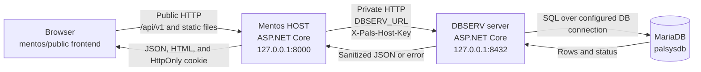
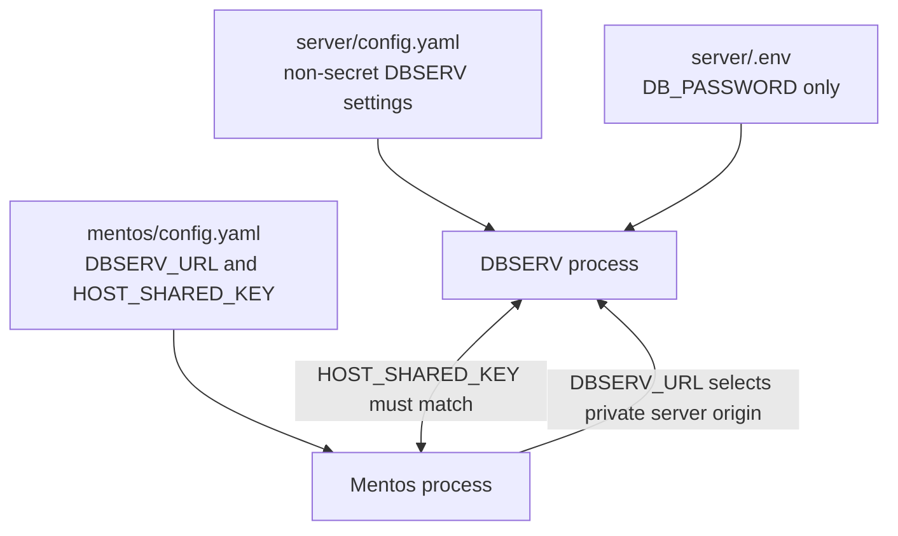

# DBSERV and Mentos connection

This is the high-level topology for the active .NET implementation. Mentos is
the browser-facing HOST. `server/` is DBSERV and must remain private from
browser JavaScript. The diagrams use Mermaid flowchart syntax; see the
[Mermaid flowchart reference](https://mermaid.js.org/syntax/flowchart).

## Configuration relationship

The browser never receives `HOST_SHARED_KEY`, database credentials, ASP.NET
Data Protection keys, or the internal DBSERV route contract.
