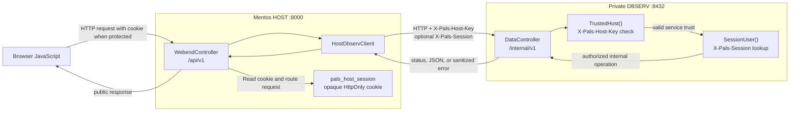
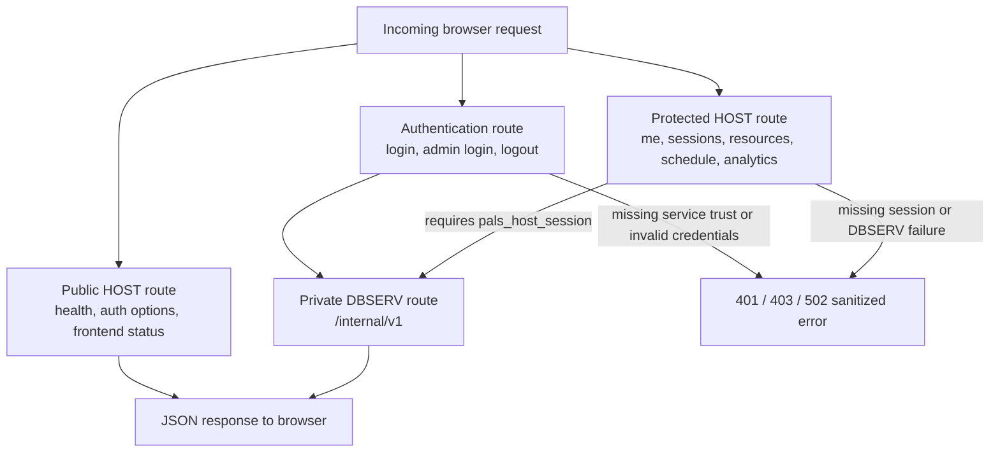

# REST API communication between Mentos and DBSERV

Mentos exposes the public `/api/v1` contract. DBSERV exposes the private
`/internal/v1` contract. Mentos translates the public request into a private
DBSERV request through `HostDbservClient`.

## Request classes

The shared host key authenticates Mentos as a service; it does not authorize a
user. User authorization comes from the persisted DBSERV session and its
server-derived account role.
