# YEa why not

This is everything in one flowchart

```mermaid
flowchart TB
    subgraph CONFIG["Configuration and startup"]
        ServerConfig["server/config.yaml\nnon-secret DBSERV settings"]
        ServerSecret["server/.env\nDB_PASSWORD only"]
        MentosConfig["mentos/config.yaml\nDBSERV_URL + HOST_SHARED_KEY"]
        ServerRuntime["DBSERV ASP.NET Core runtime\n127.0.0.1:8432"]
        MentosRuntime["Mentos ASP.NET Core runtime\n127.0.0.1:8000"]

        ServerConfig --> ServerRuntime
        ServerSecret --> ServerRuntime
        MentosConfig --> MentosRuntime
    end

    subgraph CLIENT["Browser and preserved frontend"]
        Browser["Browser"]
        PublicUI["mentos/public\nHTML, CSS, JavaScript"]
        BrowserCookie["Cookie jar\npals_host_session\nopaque HttpOnly value"]
        Browser --> PublicUI
        PublicUI --> BrowserCookie
    end

    subgraph HOST["Mentos HOST / public boundary"]
        StaticFiles["ASP.NET static-file host\npublic/*"]
        HostHealth["HostController\nGET /api/v1/health"]
        Webend["WebendController\n/api/v1"]
        PublicRoutes["Public routes\nauth/options, frontend/status"]
        AuthRoutes["Authentication routes\nauth/login, admin/login, logout"]
        ProtectedRoutes["Protected routes\nme, users, pages, tutors, tutees\nlearning requests, sessions"]
        FeatureRoutes["Feature routes\nschedule, resources, feedback\nsupport, analytics, dashboard"]
        DeferredRoutes["Recommendation aliases\nHTTP 501 until /connect is approved"]
        ReadCookie["Read pals_host_session"]
        SetCookie["Set or clear HttpOnly session cookie"]
        HostClient["HostDbservClient\nprivate HTTP client"]
        HostError["Sanitized HOST response\n502 for DBSERV failure"]
    end

    subgraph PRIVATE["DBSERV / private service boundary"]
        ServiceHealth["ServiceController\n/db /acc /sched /fb /adata\n/connect /chat health"]
        DataController["DataController\n/internal/v1"]
        DeveloperController["DeveloperController\n/dev/* direct developer interface"]
        TrustedHost{"X-Pals-Host-Key\nvalid?"}
        InternalRoute{"Internal route type"}
        AuthInternal["Auth internal routes\n/internal/v1/auth/*"]
        ProtectedInternal["Protected internal routes\n/internal/v1/me, data, features"]
        LogoutInternal["DELETE /internal/v1/auth/session"]
        SessionHeader["Optional X-Pals-Session\nopaque key"]
        SessionLookup["FindSessionUserAsync()\ncheck expiry and resolve email"]
        ActiveRole["Check active PALs account\nand server-derived role"]
        DataResponse["DBSERV JSON response"]
        Forbidden["401 / 403\ntrust or session rejected"]
    end

    subgraph AUTH["Current authentication and session logic"]
        AdminCredentials["Admin/developer email + password\noptional mfaCode"]
        IdentityStore["DeveloperIdentityStore"]
        IdentityManager["ASP.NET Identity\nUserManager / SignInManager"]
        IdentityCheck["Password, lockout, email confirmation\nrole eligibility"]
        TotpDecision{"TOTP enabled?"}
        TotpVerify["Verify authenticator code\nGoogle Authenticator-compatible TOTP"]
        MfaReplay["MfaReplayStore\nshort-lived code digest"]
        PalAccount["Find PALs account\nusers + user_roles\naccount_status = active"]
        SessionCreate["CreateSessionAsync()"]
        SessionKey["Opaque session key\n8-hour web session"]
        StudentCredentials["Student email + terms\nLASTNAME.STUID@cubao.sti.edu.ph"]
        StudentFormat["Format check\nSTUID at least 6 digits"]
        StudentProvision["ProvisionStudentAsync()\nstudent role and PALs user"]
        DirectDev["server/public developer login"]
        IdentityCookie["ASP.NET Identity application cookie"]
        AuthFailure["Generic authentication failure"]
    end

    subgraph DATA["DBSERV persistence paths"]
        PalsStore["PalsDataStore\nparameterized SQL"]
        IdentityContext["PalIdentityDbContext\nEF Core MySQL provider"]
        ReplayStore["identity_mfa_replays\nraw TOTP codes never stored"]
        MariaDB[("MariaDB\npalsysdb")]
        PalsTables["PALs tables\nusers, roles, user_roles\nprofiles, subjects, learning data"]
        IdentityTables["Identity tables\nidentity_users, identity_roles\nclaims, logins, tokens"]
        SessionTables["Session tables\nweb_sessions, schedule_events"]
        FeatureTables["Feature tables\nresources, feedback, support\nanalytics and study records"]
        MfaTable["MFA table\nidentity_mfa_replays"]
        Migration["DBA applies schema_v5-v8\nruntime dbpals remains CRUD-only"]
    end

    subgraph PLANNED["Planned OAuth/OIDC flow — not implemented"]
        AuthStart["Mentos auth-start"]
        Transaction["Server-side transaction\nstate, nonce, PKCE verifier"]
        Authorization["PALs authorization endpoint"]
        Code["One-time authorization code"]
        TokenExchange["Server-side code exchange"]
        OidcValidation["OIDC issuer, audience, signature\nnonce and expiry validation"]
        PlannedSession["Create existing DBSERV session"]
    end

    Browser -->|"GET pages and static assets"| StaticFiles
    PublicUI -->|"fetch /api/v1/*"| Webend
    BrowserCookie --> ReadCookie
    StaticFiles --> PublicUI
    Webend --> HostHealth
    Webend --> PublicRoutes
    Webend --> AuthRoutes
    Webend --> ProtectedRoutes
    Webend --> FeatureRoutes
    Webend --> DeferredRoutes
    AuthRoutes --> HostClient
    ProtectedRoutes --> ReadCookie
    FeatureRoutes --> ReadCookie
    ReadCookie --> HostClient
    DeferredRoutes --> DataResponse
    HostClient -->|"X-Pals-Host-Key\noptional X-Pals-Session"| DataController
    MentosConfig -. "shared key and private URL" .-> HostClient
    ServerRuntime -. "accepts matching shared key" .-> TrustedHost
    HostHealth --> DataResponse
    PublicRoutes --> DataResponse
    HostClient --> HostError
    DataResponse --> Webend
    Webend --> SetCookie
    SetCookie --> BrowserCookie
    Webend --> PublicUI

    DataController --> TrustedHost
    TrustedHost -->|"no"| Forbidden
    TrustedHost -->|"yes"| InternalRoute
    InternalRoute --> AuthInternal
    InternalRoute --> ProtectedInternal
    InternalRoute --> LogoutInternal
    ProtectedInternal --> SessionHeader
    SessionHeader --> SessionLookup
    SessionLookup --> PalsStore
    SessionLookup --> ActiveRole
    ActiveRole -->|"authorized"| PalsStore
    ActiveRole -->|"inactive or unauthorized"| Forbidden
    AuthInternal -->|"admin login"| IdentityStore
    AuthInternal -->|"student login"| StudentCredentials
    LogoutInternal --> PalsStore
    DataController --> DataResponse
    Forbidden --> DataResponse

    AdminCredentials --> IdentityStore
    IdentityStore --> IdentityManager
    IdentityManager --> IdentityCheck
    IdentityCheck -->|"invalid"| AuthFailure
    IdentityCheck --> TotpDecision
    TotpDecision -->|"no"| PalAccount
    TotpDecision -->|"yes"| TotpVerify
    TotpVerify --> ReplayStore
    ReplayStore -->|"new code"| PalAccount
    ReplayStore -->|"invalid or replayed"| AuthFailure
    PalAccount -->|"inactive or wrong role"| AuthFailure
    PalAccount -->|"active allowed account"| SessionCreate
    SessionCreate --> PalsStore
    PalsStore --> SessionKey
    SessionKey --> SetCookie
    AuthFailure --> DataResponse

    StudentCredentials --> StudentFormat
    StudentFormat -->|"invalid or terms missing"| AuthFailure
    StudentFormat -->|"valid"| StudentProvision
    StudentProvision --> PalsStore
    StudentProvision --> SessionCreate

    DirectDev --> DeveloperController
    DeveloperController --> IdentityManager
    IdentityManager -->|"successful direct login"| IdentityCookie
    DeveloperController --> TotpVerify
    IdentityCookie --> DirectDev

    PalsStore --> MariaDB
    IdentityContext --> MariaDB
    ReplayStore --> MariaDB
    IdentityManager --> IdentityContext
    MariaDB --> PalsTables
    MariaDB --> IdentityTables
    MariaDB --> SessionTables
    MariaDB --> FeatureTables
    MariaDB --> MfaTable
    PalsStore --> PalsTables
    PalsStore --> SessionTables
    PalsStore --> FeatureTables
    IdentityContext --> IdentityTables
    ReplayStore --> MfaTable
    Migration -. "creates and updates" .-> MariaDB

    AuthRoutes -. "future replacement" .-> AuthStart
    AuthStart -.-> Transaction
    Transaction -. "redirect" .-> Authorization
    Authorization -. "authenticate with Identity + TOTP" .-> IdentityManager
    Authorization -.-> Code
    Code -.-> TokenExchange
    TokenExchange -.-> OidcValidation
    OidcValidation -.-> PlannedSession
    PlannedSession -.-> SetCookie

    classDef browser fill:#e8f4ff,stroke:#2878b5,color:#102a43
    classDef host fill:#e9f8ef,stroke:#2d8a4e,color:#12351e
    classDef server fill:#fff2df,stroke:#c77b16,color:#4a2b05
    classDef database fill:#f3eaff,stroke:#7b4bb3,color:#29153e
    classDef planned fill:#f4f4f4,stroke:#777,color:#444,stroke-dasharray: 5 5

    class Browser,PublicUI,BrowserCookie browser
    class StaticFiles,HostHealth,Webend,PublicRoutes,AuthRoutes,ProtectedRoutes,FeatureRoutes,DeferredRoutes,ReadCookie,SetCookie,HostClient,HostError host
    class ServiceHealth,DataController,DeveloperController,TrustedHost,InternalRoute,AuthInternal,ProtectedInternal,LogoutInternal,SessionHeader,SessionLookup,ActiveRole,DataResponse,Forbidden,IdentityStore,IdentityManager,IdentityCheck,TotpDecision,TotpVerify,PalAccount,SessionCreate,SessionKey,StudentFormat,StudentProvision,DirectDev,IdentityCookie,AuthFailure server
    class PalsStore,IdentityContext,ReplayStore,MariaDB,PalsTables,IdentityTables,SessionTables,FeatureTables,MfaTable,Migration database
    class AuthStart,Transaction,Authorization,Code,TokenExchange,OidcValidation,PlannedSession planned
```

This single map combines the active browser, Mentos, DBSERV, Identity, MFA,
session, and MariaDB paths. Solid connections are active behavior; dashed
connections are the planned OAuth/OIDC replacement and are not implemented yet.
