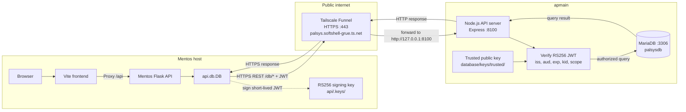
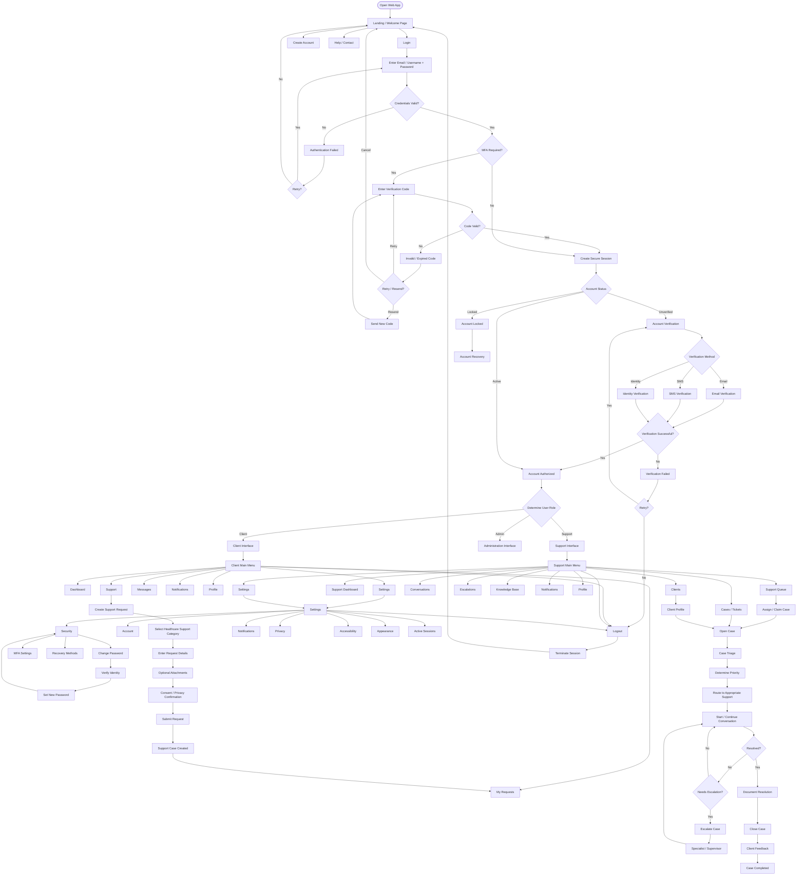

The intended request/response path is Mentos `api.db.DB` → HTTPS on the public
Tailscale Funnel (port 443) → the Node API's private listener on `apmain:8100` → JWT
validation → MariaDB on `apmain:3306`; the response returns along the same
path. HOST configures `DBSERV_URL=https://palsys.softshell-grue.ts.net`;
the DB client normalizes the trailing slash and appends `/db/...`.
Funnel reachability and its forwarding target have not been tested or
configured by this project.

The host signs short-lived RS256 tokens with its private key; the database API
validates them using the matching trusted public key. See
`server/database/README.md` for key provisioning and the shared
POST/GET/PATCH/DELETE/aggregation request contract. Set `DBSERV_URL`, `JWT_ISSUER`,
`JWT_AUDIENCE`, `JWT_PRIVATE_KEY_PATH`, and `JWT_KEY_ID` in `api/.env` (the
legacy `api/src/api/db/.env.config` path is also supported) or the process
environment.
The detailed database server documentation is at `../../../server/database/README.md`.

